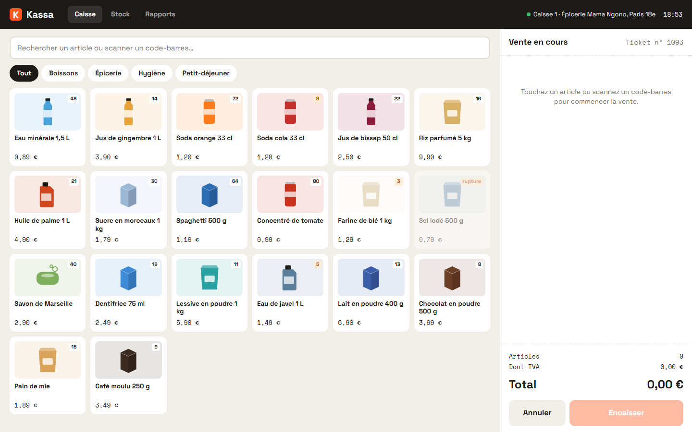
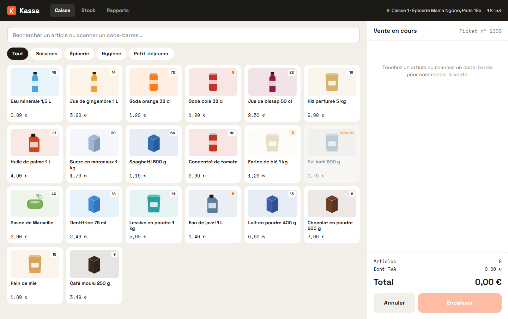
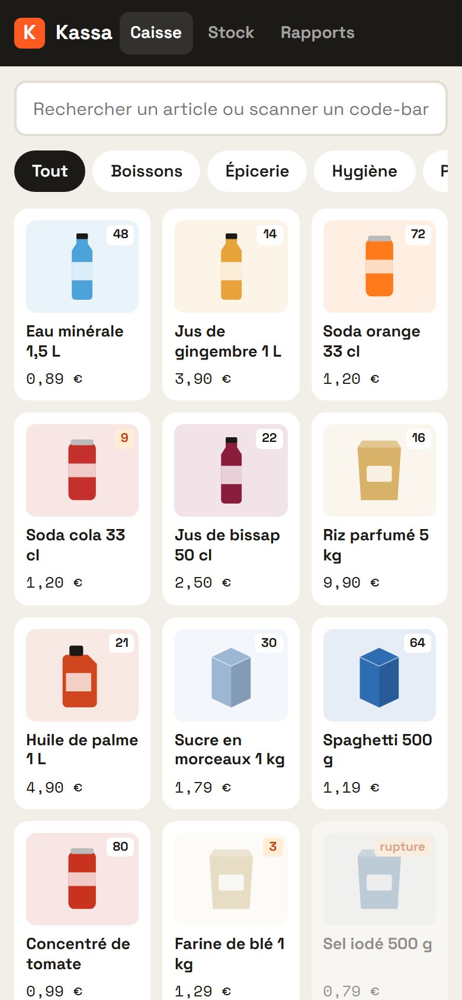

# Kassa

**Caisse et gestion de stock** — Logiciel de caisse tactile pour une épicerie de quartier : catalogue par familles, recherche et lecture de code-barres, ticket en cours, encaissement en espèces avec rendu monnaie, par Wero ou par carte, ticket de caisse imprimable, stock décrémenté avec alertes et rapports de la journée.

**Démo en ligne : [https://lordlennyx.github.io/kassa-caisse/](https://lordlennyx.github.io/kassa-caisse/)**

Spot de présentation (30 s) : [media/spot-30s.mp4](https://lordlennyx.github.io/kassa-caisse/media/spot-30s.mp4)

## Ce que le projet montre

- Caisse tactile : familles, recherche sans accents, code-barres au clavier ou à la douchette
- Ticket en cours avec quantités, TVA incluse et contrôle du stock disponible
- Encaissement espèces (billets en euros suggérés, pavé numérique, monnaie à rendre), paiement mobile Wero avec contrôle du numéro, carte
- Ticket de caisse 80 mm imprimable
- Stock : niveau par article, seuil d'alerte, réceptions, valeur du stock
- Rapports : chiffre d'affaires, panier moyen, marge brute, ventes par heure, moyens de paiement, meilleures ventes

## Réalisation

- **Stack :** HTML, CSS, JavaScript natif, SVG
- **Typographies :** Space Grotesk, Space Mono
- **Évolutions possibles :** mode hors ligne (PWA) avec synchronisation, imprimante thermique ESC/POS, API de paiement réelle (Wero, Stripe Terminal), multi-caisses

| Bureau | Mobile |
|---|---|
|  |  |

---

Client et contenus fictifs, créés pour la démonstration. Conception, design et développement : **Njundiyimun Béchard** — [github.com/LordLennyx](https://github.com/LordLennyx)
